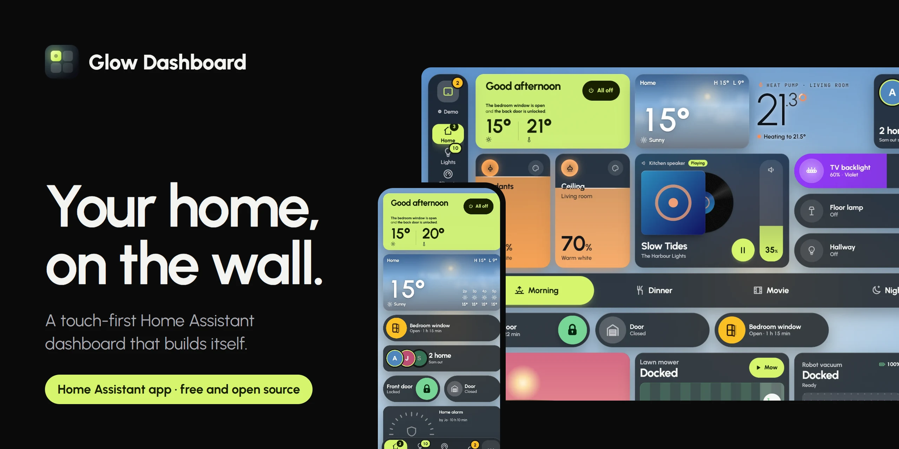
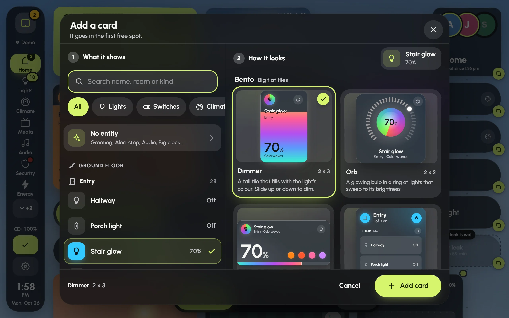

  

  

  <b><a href="https://dawsonjkraai.github.io/glow-dashboard/#demo">Try the demo house</a></b> &nbsp;·&nbsp;
  <a href="https://dawsonjkraai.github.io/glow-dashboard/guides/getting-started.html">Guides</a> &nbsp;·&nbsp;
  <a href="https://dawsonjkraai.github.io/glow-dashboard/">Website</a> &nbsp;·&nbsp;
  <a href="glow_dashboard/CHANGELOG.md">What's new</a>

Glow Dashboard is a touch-first dashboard for Home Assistant, made for a tablet on the wall and the
phone in your hand. Five questions build it from what your home has; then every card moves, resizes
and swaps by touch. It lives in Home Assistant's sidebar as an app (apps were called add-ons before
Home Assistant 2026.2).

<table>
  <tr>
    <td width="50%"></td>
    <td width="50%"></td>
  </tr>
  <tr>
    <td><b>Your whole home on one screen.</b> Lights as dimmers that fill with their own colour, the heating, the music, the doors and one-tap modes.</td>
    <td><b>It builds itself.</b> Where the screen goes, what it shows, which rooms, which look: then it draws the pages before it makes them.</td>
  </tr>
  <tr>
    <td></td>
    <td></td>
  </tr>
  <tr>
    <td><b>Modes take the screen.</b> Shower, theatre, party, bedtime and cooking: exactly what that moment needs, and one tap back.</td>
    <td><b>A screensaver with the song.</b> When music plays in the room, skip or change the volume without waking the dashboard.</td>
  </tr>
  <tr>
    <td></td>
    <td></td>
  </tr>
  <tr>
    <td><b>Music in every room.</b> Tick the rooms, pick a playlist, set each room's level. With Music Assistant, rooms join and leave without the music stopping.</td>
    <td><b>Move anything by touch.</b> Pick a thing, pick one of over a hundred card styles, place it and pull a corner to resize it. No YAML.</td>
  </tr>
</table>

## What's in it

- **A setup wizard** that builds a dashboard from your areas and devices, and fills an empty one with a tap.
- **An editor for fingers**: drag to move, pull a corner to resize, hold an empty spot to add. Undo is one tap away.
- **Found automatically**: add an integration to Home Assistant and its cards appear on the page they belong to, with a notice and an Undo.
- **Lights that look like light**: main lights as big dimmers, ambient ones as glowing chips, WLED strips showing what their LEDs are doing.
- **Music Assistant and Spotify**: rooms, presets, the queue, big playlists a page at a time, album art kept at home.
- **Cameras and alerts**: Frigate people and packages, the doorbell full screen, the alarm, quiet hours.
- **Looks**: six palettes, glass or solid cards, a live sky, aurora or your own photo behind them.
- **Made for a cheap tablet**: tuned for the Amazon Fire HD 10 and its old browser. Effects step down by themselves when frames drop.
- **Every screen in step**: dashboards are kept in Home Assistant, so a change on one screen shows on all of them.

## Install

1. Press the **Add to Home Assistant** button above, or in Home Assistant go to **Settings › Apps**,
   press **Install app**, open the **⋮** menu, choose **Repositories** and add `https://github.com/dawsonjkraai/glow-dashboard`.
2. Find **Glow Dashboard** in the store, install it and press **Start**.
3. Turn on **Show in sidebar** and open **Glow**. The setup wizard opens by itself.

Apps need Home Assistant OS. [Getting started](https://dawsonjkraai.github.io/glow-dashboard/guides/getting-started.html) walks through it,
and [Wall tablets](https://dawsonjkraai.github.io/glow-dashboard/guides/wall-tablets.html) covers kiosk browsers and the optional no-sign-in
port.

## Guides

| Start | Make it yours | Every day | When something's off |
| --- | --- | --- | --- |
| [Getting started](https://dawsonjkraai.github.io/glow-dashboard/guides/getting-started.html) | [Editing your dashboard](https://dawsonjkraai.github.io/glow-dashboard/guides/editing.html) | [Modes](https://dawsonjkraai.github.io/glow-dashboard/guides/modes.html) | [Troubleshooting](https://dawsonjkraai.github.io/glow-dashboard/guides/troubleshooting.html) |
| [The setup wizard](https://dawsonjkraai.github.io/glow-dashboard/guides/setup-wizard.html) | [Colours and backgrounds](https://dawsonjkraai.github.io/glow-dashboard/guides/looks.html) | [Music](https://dawsonjkraai.github.io/glow-dashboard/guides/music.html) | |
| [Wall tablets](https://dawsonjkraai.github.io/glow-dashboard/guides/wall-tablets.html) | | [Lights](https://dawsonjkraai.github.io/glow-dashboard/guides/lights.html) | |
| | | [Screensaver and night](https://dawsonjkraai.github.io/glow-dashboard/guides/screensaver-and-night.html) | |
| | | [Found automatically](https://dawsonjkraai.github.io/glow-dashboard/guides/found-automatically.html) | |

## Privacy

Glow talks only to your Home Assistant, and to the music services' own picture servers for album art,
which it keeps a copy of at home. Nothing is sent anywhere else. The demo house on the website is
made up and runs entirely in your browser.

## Licence

MIT. See [LICENSE](LICENSE). Glow Dashboard isn't affiliated with Home Assistant or Nabu Casa.
