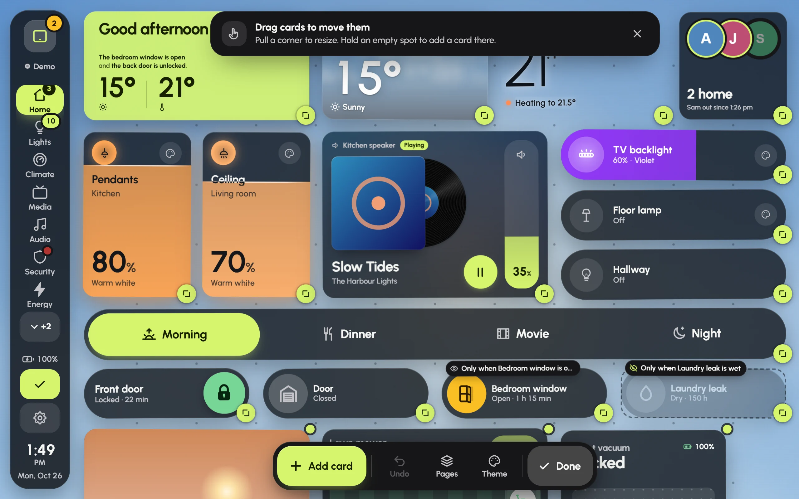

Every card on a dashboard can be moved, resized, restyled or removed by touch. It all happens on the dashboard itself, in edit mode.

## Edit mode

Press the **pencil** at the foot of the rail. On a phone, open **⋯** in the bar and choose **Edit page**. If the dashboard has an edit PIN, Glow asks for it first.

The cards jiggle gently and a toolbar appears along the bottom: **Add card**, **Undo**, **Pages**, **Theme** and **Done**. Press **Done** when you've finished.

Edit mode: a handle on every card's corner, the toolbar at the bottom, and badges on cards that only show at certain times.

- **Move a card**: press and drag it. On a touch screen, hold it still for a moment before you drag, so a quick swipe still scrolls the page. The other cards slide out of the way, and a ghost shows where it will land.
- **Resize a card**: pull the handle on its corner. It snaps to the grid and shows the size, such as "3 × 2", while you drag. Each card style has the sizes it looks right at, so some stop growing or shrinking.
- **Add a card in a particular spot**: hold an empty spot on the grid. **Add a card** opens, and the new card goes where you pressed.
- **A card's own tools**: tap a card to select it. Small buttons appear for its settings, **Duplicate** and **Delete**. A deleted card can come back with **Undo** in the message that appears.

**Undo** in the toolbar takes back the last change, one step at a time.

## Add a card

Press **Add card** in the toolbar. The sheet has two steps.

1. **What it shows.** Search by name, room or kind, or filter by **Lights**, **Switches**, **Climate** and so on. Everything is grouped by floor and room, with its state now. **No entity**, at the top, holds the cards that stand on their own, such as the greeting, clocks, the Audio player and mode buttons.
2. **How it looks.** Live previews of every card style that fits, grouped by family, each with its size, such as "2 × 3". Tap one to choose it. On a phone, swipe through the looks.

Press **Add card** at the bottom. The card lands in the first free spot (or where you pressed), scrolls into view and pulses. Drag and resize it from there.

Adding a light: the Stair glow light picked on the left, and its Dimmer style chosen from live previews on the right.

## Card settings

In edit mode, tap a card, then its settings button. The sheet holds everything about that card.

- **Shows** and **Style**: change what the card shows, or swap it for another style. Its size is kept when the new style allows it.
- **Look**: how see-through it is, **No card behind it**, a **Tint**, its **Corners**, whether it shows its name and state, and its own **Motion**. Each follows the dashboard until you change it.
- **Name and icon**: your own name or icon for this card.
- The style's own options, under the style's name.
- **The light** (light cards only): **Response while dragging**, and whether **This light is** a main or an ambient light. See [Lights](lights.md).
- **Tap and hold**: what a tap and a press-and-hold do.
- **Show on**: **Phone**, **Tablet** and **Wide**. Untick one to hide the card on that size of screen.
- **Only show when**: conditions that decide when the card appears.
- **Alerts**: **Alert me when…** sets up a pop-up or a banner about this card's device on every screen.
- **Duplicate** and **Delete card**.

Changes apply as you make them. Press **Done** to close the sheet.

### Tap and hold

Each gesture can do one of these:

- **Default**: the card's own behaviour. For most cards a tap switches the device, and a hold opens its details.
- **Nothing**: ignore the gesture.
- **Toggle**: on and off. Locks and alarms open their controls instead, so a stray tap never unlocks a door.
- **Open details**: the full controls and history, of this device or another one.
- **Go to a page**: another page of this dashboard.
- **Run an action**: any Home Assistant action, such as a script, with a target and optional data.

### Only show when

Conditional cards keep a wall tablet calm. They appear only when they matter: a window left open, the washer finished, music playing, the evening. Press **Add a condition** and choose:

- **A device or sensor**: its state is, or isn't, something; or a number is above or below a line. A margin stops it flickering around the line, and **For at least** waits until it has held for a while.
- **The time of day**: between two times, on the days you pick (**Every day**, **Weekdays**, **Weekends** or your own).
- **Either of several**: any one of a group of conditions is enough.

With several conditions, the card shows only while all of them hold, and the sheet tells you whether it would be showing right now. Outside edit mode, a hidden card leaves no gap: the cards around it close up. In edit mode it shows faded, with a badge such as "Only when Bedroom window is open".

## Pages

**Settings › Pages** (or **Pages** in the edit toolbar) lists the dashboard's pages in the order the navigation shows them.

- Drag the grip on the right of a page to change the order.
- **Add a page** makes a new, empty page.
- Open a page to rename it, change its icon, press **Make this the home page**, or **Delete page**.
- **Add the Audio page** appears when the dashboard has no music page yet.

The home page is where the dashboard opens, and where it goes back to after a quiet spell. Three minutes is the default; change it in **Settings › Behaviour › Going home**.

## Who can save changes

Dashboards are shared through Home Assistant, and only Home Assistant administrators can save them.

- On a screen signed in as an administrator, changes are saved for every screen as you make them.
- On a screen signed in as an ordinary user, such as a wall tablet with its own user, changes wait on that screen. **Settings › Security › Saving shared dashboards** lists them, with **Publish them now** and **Throw them away**.
- **Unlock editing (admin sign-in)**, in the same place, lets an administrator sign in on that screen for a while. It locks again by itself after 10 minutes without a save.

Often the easiest way is to make changes from your own phone or computer, signed in as yourself, and let the tablet pick them up.

## The edit PIN

An edit PIN keeps little hands and curious guests from moving cards around or changing settings by accident.

1. Go to **Settings › Security**.
2. Under **Edit PIN**, press **Set a PIN**.
3. Choose 4 to 8 digits, then enter them again.

From then on, Glow asks for the PIN before edit mode and Settings. Once it's entered, it isn't asked again for five minutes. After five wrong tries, the keypad rests for 30 seconds. **Change PIN** and **Remove PIN** are in the same place, and **Use it on every dashboard** copies it to the others.

The PIN isn't security: anyone who can reach Home Assistant can still change the dashboards there. Locks, the alarm and garage doors always ask for a deliberate slide, hold or code, PIN or not.
