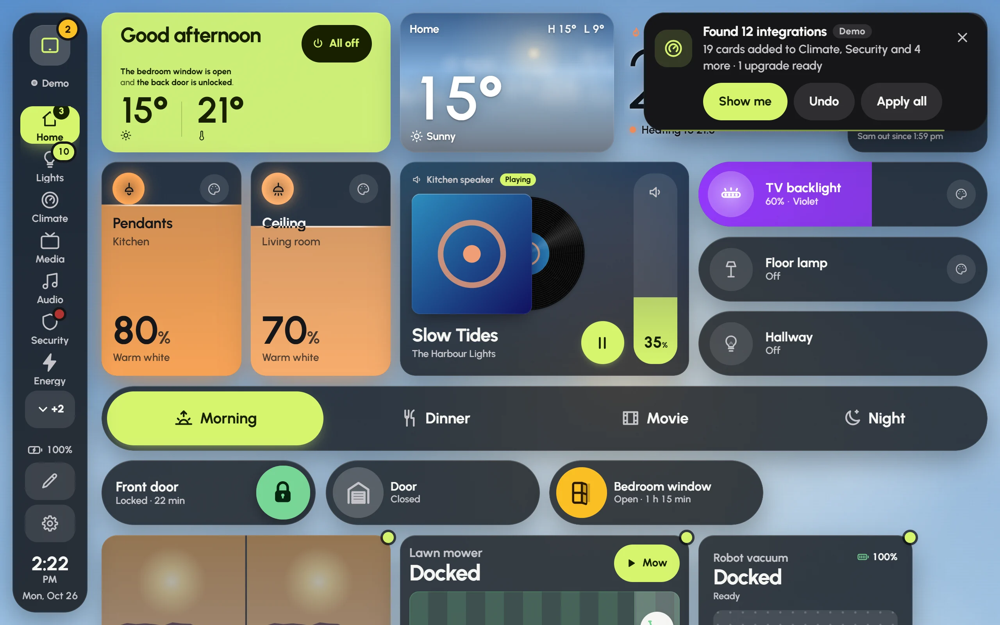

Add a device or an integration to Home Assistant, and Glow notices. A new WLED strip, a camera, a washing machine or a calendar gets a card on the page it belongs to, without anyone adding it by hand.

## What it does

- **Cards go on the page that fits**: lights on Lights, a camera on Security, and on a dashboard laid out by room, the room's own page.
- **Your cards stay put.** New cards go after yours, in free space. Glow never moves, restyles or removes a card you placed.
- **Gone means gone.** A card you delete, or anything you undo, is remembered and never comes back on its own.
- **Alerts come along.** A new device's alerts can switch on with it, such as a warning when a leak sensor gets wet.
- **Some dashboards are left alone.** A blank dashboard is yours to build, and a room's own dashboard is left alone unless you switch it on under **Adds to** (below).
- **What you left out in the setup stays out.** See [the setup wizard](setup-wizard.md#left-out-stays-out).
- **A little at a time.** At most 8 new cards per page and 24 at once; the rest wait in Settings.
- **Only a screen that can save** the shared dashboards (an administrator's) adds anything. Other screens show what would be added.

Glow looks when Home Assistant starts and again shortly after its devices change. It waits while someone is editing or has Settings open.

## The notice

The notice after Glow found the demo house's integrations, with **Show me**, **Undo** and **Apply all**. The small dots mark new cards.

When something is added, a notice appears in the top corner for about 15 seconds (a finger on it holds it), such as "Found WLED · 3 live strips added to Lights".

- **Show me** goes to the page, scrolls to the new cards and makes them pulse.
- **Undo** takes back exactly what was added that time: cards, pages and alerts. They won't come back by themselves.
- **Apply all** appears when better card styles are on offer for cards you already have (see below).

New cards wear a small dot on their corner until their page has been on screen for a few seconds. The notice also stays in the notification shade, with the same buttons.

## Settings › Integrations

**When something new turns up** sets how Glow behaves:

- **Auto** (the default): cards are added, with a notice and **Undo**.
- **Ask first**: a notice says what turned up, with **Add them** and **Not now**. Nothing changes until you say.
- **Off**: nothing is added on its own. **Check now** still shows what could be.

Under it:

- **Adds to**: which dashboards Glow may add to.
- **Added lately**: each recent addition, with **Show me** and **Undo**.
- **Waiting for you**: cards on offer, with **Add**. **Better cards for what you have** offers a style made for a device in place of a plain card, in the same spot, with **Upgrade**, **Not now** or **Apply all**; these are only ever offered, never made by themselves. **Alerts you could switch on** has **Turn on**.
- **Found in this house**: every integration Glow found. Open one to see what it added, switch off **Add new ones by itself** for it, **Add again** what was removed, or **Remove what it added**. Some send you elsewhere: music to **Settings › Audio**, photos to the screensaver, and **See the modes** to the modes it makes possible.
- **Not installed**: integrations Glow knows how to use that your Home Assistant doesn't have yet. Each says what it gives, whether it's **Built in**, from **HACS**, an **App** or a **Helper**, and the steps to install it. Once it's installed, Glow finds it by itself.
- **Check now** looks again straight away.
