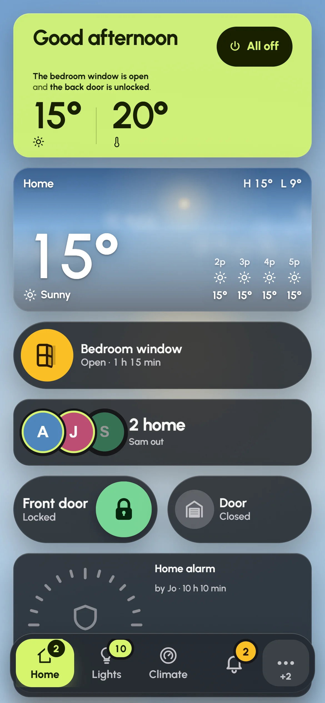

Glow Dashboard is a Home Assistant dashboard made for touch: a tablet on the wall, a phone in your hand. It comes as a Home Assistant app (apps were called add-ons before Home Assistant 2026.2) and lives in the sidebar as **Glow**. A short setup builds your first dashboard from what your home has, and every card can then be moved, resized and swapped with a finger.

## What you need

- Home Assistant OS. Apps need its Supervisor, which Container and Core installs don't have.
- A browser from the last few years on each screen. Glow is tuned for the Amazon Fire HD 10, so most tablets keep up.

## Install the app

1. In Home Assistant, go to **Settings › Apps** and press **Install app**.
2. Open the **⋮** menu in the top corner and choose **Repositories**.
3. Paste `https://github.com/dawsonjkraai/glow-dashboard`, press **Add**, then close the window.
4. Find **Glow Dashboard** in the store, open it and press **Install**.

You can also [add the repository with one link](https://my.home-assistant.io/redirect/supervisor_add_addon_repository/?repository_url=https%3A%2F%2Fgithub.com%2Fdawsonjkraai%2Fglow-dashboard). It opens your own Home Assistant with the address filled in. The first time you use a link like this, it asks where your Home Assistant is.

## Start it and open Glow

1. On the app's page, press **Start**.
2. Turn on **Show in sidebar**.
3. Press **Glow** in Home Assistant's sidebar.

The app starts again by itself whenever Home Assistant does. In the sidebar, Glow uses your own Home Assistant sign-in, so there is nothing else to sign in to.

## The first run

When your Home Assistant has no Glow dashboards yet, the setup wizard opens by itself. It asks five short questions, draws the pages it will make, and makes them when you press **Build it**. [The setup wizard](setup-wizard.md) walks through each step.

Press **Not now** if you'd rather look around first. An empty dashboard then shows **Set it up for me**, which opens the same wizard whenever you're ready.

## Where your dashboards are kept

Your dashboards are saved in Home Assistant, not on the tablet or phone. Every screen in the house sees the same ones, and a change made on one screen appears on the others.

- Each screen picks which dashboard it shows, under **Settings › This screen › Dashboard on this screen**. The kitchen tablet can show one dashboard and your phone another.
- A few settings stay on one screen only: its name, keeping the screen awake, its effects, and which room it's in for music. They live in **Settings › This screen** and **Settings › Audio**.
- Only Home Assistant administrators can save changes to the shared dashboards. A screen signed in as an ordinary user keeps its changes waiting until an administrator unlocks editing. [Editing your dashboard](editing.md#who-can-save-changes) explains.
- On Home Assistant older than 2025.12, dashboards are saved for the signed-in user instead of being shared with everyone.

## Try the demo house

The demo house is a made-up home with three people (Alex, Jo and Sam) and rooms such as the Kitchen, the Living room and the Garden. Its values change on their own, and nothing in it reaches a real home. It's a good way to see every card and mode before you touch your own lights.

- In any browser: [touch the demo house](https://dawsonjkraai.github.io/glow-dashboard/#demo) on the project's page.
- On a screen that opens Glow on the app's own port (see [Wall tablets](wall-tablets.md)): choose **Try the demo house** on the first screen, or later go to **Settings › Connection** and press **Show the demo house**. **Settings › Connection** also takes you back to your home.

Inside Home Assistant's sidebar, Glow always shows your own home, so the demo house isn't offered there.

## Finding your way around

The demo house's Home page on a 1280 × 800 tablet, with the pages in the rail on the left and the pencil and gear at its foot.

- **Pages.** The rail down the side lists the dashboard's pages. A badge shows how many of a page's lights are on, and a red dot marks a page where something needs a look, such as an open door.
- **Cards.** Tap a card to do the obvious thing: switch a light, play or pause the music. Hold it to open its details, with every control it has.
- **Notifications.** Pull down from the top edge of the screen, or press the square button at the top of the rail, to open the notification shade. It holds alerts, what Glow has found, and a row of modes.
- **Editing and Settings.** The pencil at the foot of the rail starts editing the page, and the gear opens Settings.

The same dashboard on a phone: the cards rearrange for the narrow screen, and the pages move to a bar along the bottom. The pencil and Settings are under **⋯** in that bar.

## Settings at a glance

Open Settings with the gear. **Search settings** at the top finds any setting by name. Sections that belong to one dashboard say which dashboard they change.

- **Connection**: how this screen reaches Home Assistant.
- **This screen**: what stays on this device: its name, its dashboard, keeping awake, effects and the nightly reload.
- **Dashboards**: make, rename, copy and delete dashboards.
- **Pages**: a dashboard's pages, their order, names, icons and home page.
- **Appearance**: the palette, glass or solid cards, the background, spacing and text size.
- **Behaviour**: going back to the home page, night mode, navigation and weather.
- **Screensaver**: what shows while nobody is using the screen.
- **Modes**: full-screen modes such as Shower, Theatre and Party.
- **Calendars**: each calendar's colour and whose it is.
- **Alerts**: full-screen alerts, banners, the alarm, the doorbell and quiet hours.
- **Audio**: speakers, rooms, volume and presets.
- **Integrations**: what Glow found in your Home Assistant, and what it added for it.
- **Security**: the edit PIN, saving shared dashboards, and alarm codes.
- **Backup**: download a copy of your dashboards, bring one back, or start over.
- **About**: versions, where your dashboards are kept, and details of this device.
