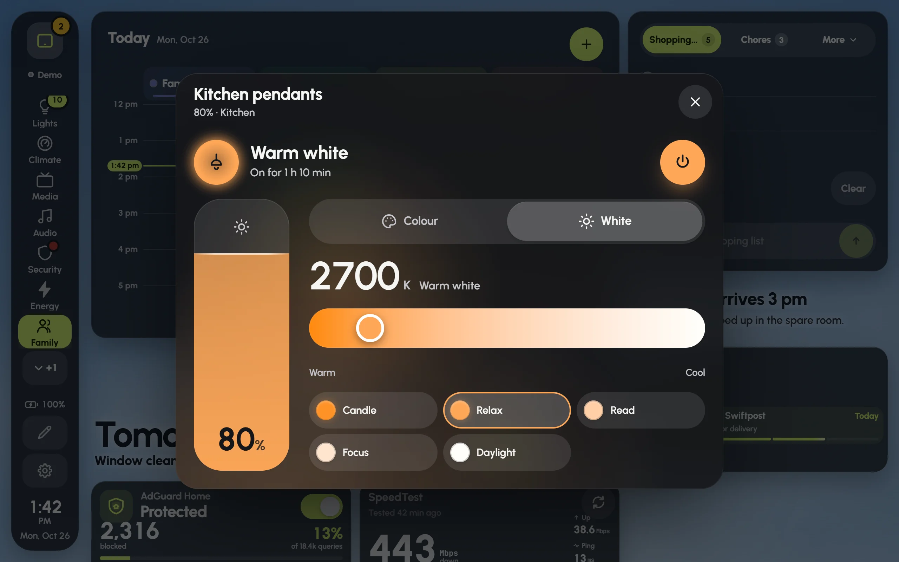

## Main and ambient lights

Glow sorts your lights into two kinds:

- **Main** lights light the room: ceilings, pendants, recessed lights, the ones on the wall switch.
- **Ambient** lights set a mood: mirrors, cabinets, LED strips, lamps.

Dashboards that Glow builds give main lights big dimmers and ambient lights smaller glowing cards, side by side. The **Room** light card shows a room's lights in **Main** and **Ambient** sections, each with its own switch. The **Ambient** card gathers a room's mood lights with one switch, one brightness and one colour for all of them.

Glow decides which is which from a label on the light in Home Assistant (such as main, overhead or ceiling; ambient, accent or mood), or else from its name and hardware. WLED strips count as ambient. To change it for one light:

1. In edit mode, tap the light's card and open its settings.
2. Under **The light**, set **This light is** to **Main**, **Ambient** or **Automatic**.

The choice applies to every card showing that light, on every screen. (On a screen that can't save shared dashboards, it waits on that screen; see [Who can save changes](editing.md#who-can-save-changes).)

## The dimmer card

Two dimmers, Pendants and Ceiling, filled with their warm white at 80% and 70%, beside slimmer light cards for the TV backlight, a floor lamp and the hallway.

The **Dimmer** is a tall card that is itself the dimmer.

- **Slide** up or down anywhere on it to dim. It starts from where the light is, without jumping, and the fill follows your finger.
- **The fill** rises to the brightness in the light's own colour, so a warm white light fills warm and a violet strip fills violet.
- **Tap** to switch the light on or off.
- **Hold** to open the light's details.
- **The round button** in the top corner opens colour, white and effects.

The **Capsule** works the same way as a pill: slide sideways to dim.

A card changes the moment you touch it, without waiting for the light. If the light doesn't follow, the card goes back and says so.

## A light's details

The Kitchen pendants' details: the brightness pill on the left, and the white temperature with its ready-made whites.

Hold a light card, or press its round colour button, to open its details.

- **At the top**: what the light is doing, how long it's been on or off, and a big power button.
- **The brightness pill**: slide it to dim. The level shows at its foot.
- **Colour**: a colour wheel, with quick colours under it.
- **White**: a warm-to-cool slider in kelvin, with ready-made whites such as Candle, Relax, Read, Focus and Daylight.
- **Effects**, for lights that have them.

A light that only dims shows **Levels** instead, and one that only switches shows **Power**.

## Response while dragging

In a light card's settings, **The light › Response while dragging** sets how often Glow updates the light while your finger moves:

- **Instant**: about 25 updates a second, for Wi-Fi lights on a good network.
- **Fast**: about 12 a second. The default for most lights.
- **Steady**: 5 a second. Easier on Z-Wave and busy Zigbee networks.
- **Gentle**: twice a second, for slow or cloud lights.

**Automatic** picks by hardware: Wi-Fi and Zigbee lights get Fast, and Z-Wave lights get Steady.

## WLED strips

Glow finds WLED strips by itself and treats them like any other light, with the same cards and the same fill. The difference is that the fill shows what the LEDs are doing right now, as a soft blend of their live colours: when an effect moves along the strip, it moves across the card.

- **The app does the work.** It follows each strip's live colours once and shares them with every screen, so a tablet doesn't have to.
- **The strip's details** show the strip itself, with a badge: **Live** for the real LEDs, or **Simulated** with a reason. Tap the badge to see why. Under it are WLED's own effects, palettes, speed, intensity, presets and playlists.
- **The WLED strip card** draws the strip itself: its real LEDs, live from WLED.

**Simulated** usually means WLED's own page is showing the strip's live view; the real colours come back by themselves when it closes. If a strip stays simulated, see [Troubleshooting](troubleshooting.md#wled-isnt-live).
