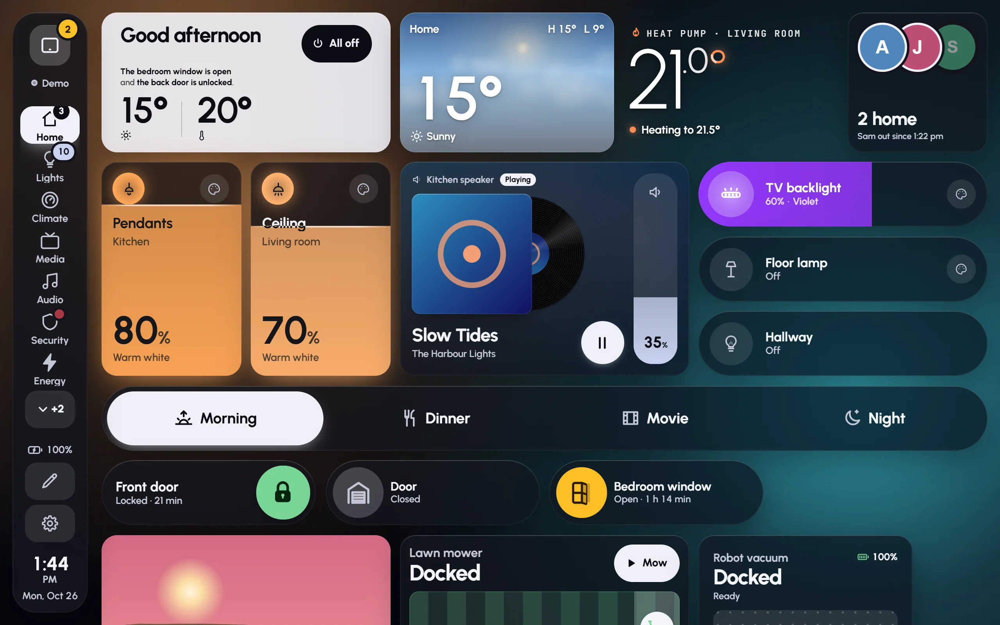
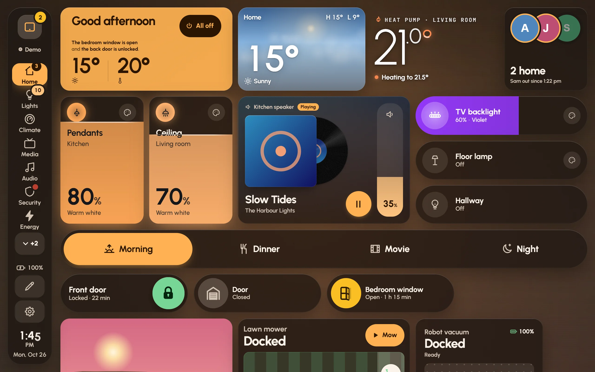
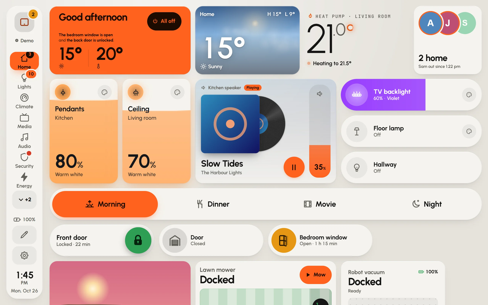

Each dashboard has its own look, set in **Settings › Appearance**. Changes show straight away, so you can try things and watch the result. **Theme** in the edit toolbar opens the same place.

## Palettes

There are six palettes. Each sets the colours of the cards, the text and the accent.

| Palette | What it's like |
|---|---|
| **Graphite** | Neutral graphite with one lime accent. Big, calm tiles. |
| **Aurora** | All neutral, so the colour comes from your lights. |
| **Ember** | Warm charcoal and amber, the colour of a lamp left on. |
| **Console** | A dark desk with ice-blue LEDs. |
| **Midnight** | Navy with a coral accent; rooms glow with their own lights. |
| **Faceplate** | A light hardware panel: off-white, black ink, signal orange. |

**Accent**, under the palettes, changes the colour of switches, sliders and the things that are on. Leave it on the palette's own unless you want a different one.

Aurora: white marks what's on, and the background's soft pools take their colours from the lights.

Ember: warm charcoal with amber.

Faceplate, the light palette: off-white, black ink and signal orange.

## Glass or solid

Under **Material**:

- **Glass**: cards are frosted panes over the background and take on its colours. The frost is worked out once rather than on every frame, so it stays smooth even on a modest tablet.
- **Solid**: opaque cards on a calm ground. The easiest to read from across a room, and the least work for a tablet.

Every card works in both. A screen with reduced effects (a Fire tablet starts that way) shows solid cards whatever the dashboard says; see [Wall tablets](wall-tablets.md#the-amazon-fire-hd-10).

**Cards** sets how much of the background shows through every card (**Card transparency**). One card can go further in its own settings, under **Look**.

## Backgrounds

Under **Background**:

- **Live sky**: the sky outside, moving with the time and the weather.
- **Still sky**: the same sky, repainted as the light changes.
- **Aurora**: soft pools in the colours of the lights that are on.
- **Gradient**: the palette's colours, slowly drifting.
- **Plain**: one calm colour.
- **Photo**: your own picture. **Choose a photo** takes one from this device and keeps it on this screen only; **Use a link** takes a picture's address, which works on every screen.

Backgrounds show behind glass cards. With solid cards the page sits on the palette's own ground instead, though the aurora still drifts behind them.

**Dim the background** darkens only what's behind the cards, so they stand out on a busy photo or a bright sky.

## Shape and size

- **Card corners**: from square to very round.
- **Space between cards**: **Snug**, **Comfortable** or **Airy**.
- **Text size**: bigger for reading from across the room, smaller to fit more in.

## Motion

**Motion** sets how much moves on the dashboard:

- **Lively**: fans spin, doors swing, music bars dance, within what the screen can afford.
- **Calm**: the same, slower and softer. Night mode and a quiet spell with nobody about switch to this by themselves.
- **Still**: no looping motion at all. Changes still show, as quick fades.

**Effects behind cards** adds a quiet layer behind some cards: a warm glow while the heating runs, frost for the air conditioning, water for humidity, the album's colours while music plays. **Effect strength** turns it down.

A single screen can ask for less, whatever the dashboard says: **Settings › This screen › Motion on this screen**.

## Night mode

**Settings › Behaviour › Night mode** dims the whole screen at night, so the hallway isn't lit up. It's on by default, from 10 pm to 6:30 am.

1. Under **When**, choose **Sunset to sunrise** or **Set times**. Sunset to sunrise needs Home Assistant's Sun integration.
2. For set times, fill in **From** and **Until**.
3. Slide **How dark at night** until it's right for the room.

Pop-ups and sheets dim along with the page, and card animations calm down. With Fully Kiosk's JavaScript interface, Glow turns the tablet's backlight down instead of laying a dark layer over the screen. The screensaver has a night look of its own; see [Screensaver and night](screensaver-and-night.md).
