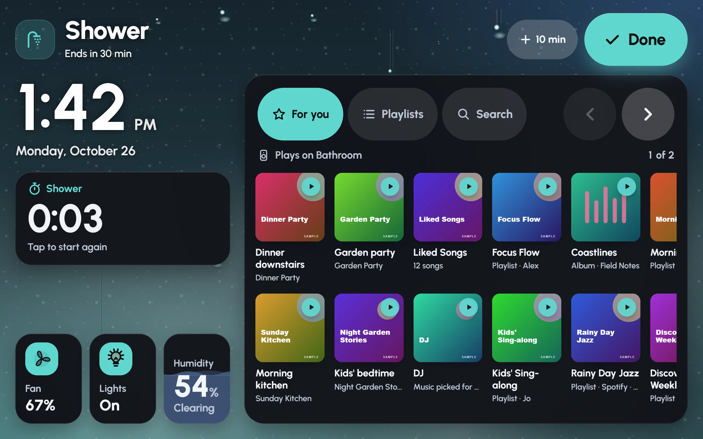
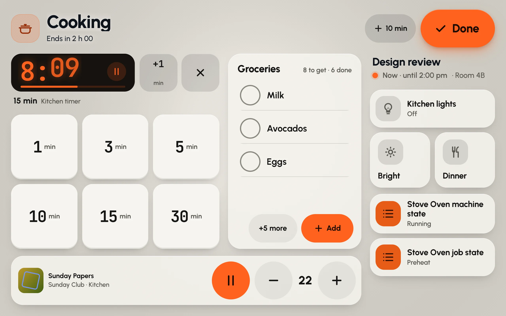

A mode takes over the whole screen for one activity, with its own look and only the controls that activity needs. Shower mode shows music for the bathroom speaker, a shower timer, the fan and the humidity. Theatre mode is a big remote in near-black. When you've finished, **Done** brings the dashboard back.

## The modes

| Mode | What it brings |
|---|---|
| **Shower** | Music on the bathroom speaker, a shower timer, the fan and the steam. |
| **Theatre** | A big remote in near-black, the lights down, and the doorbell as a quiet banner. |
| **Party** | Music everywhere, a light show, and an exit that needs a hold. |
| **Bedtime** | Lock up, arm for the night, lights off gently; then deep red and dark. |
| **Away** | The alarm, the cameras and what is still open, until someone comes home. |
| **Vacation** | Away, plus heating and hot water set back, lights at random and the days until you're back. |
| **Cooking** | Big timers, the shopping list, the kitchen lights and music, for floury hands. |
| **Cleaning** | The robot vacuum, every light up, upbeat music and quiet notifications. |
| **Sim racing** | Monitors to the sim, rig power with live watts, the lights and do-not-disturb. |
| **Guest** | A simple screen for guests: their room, the Wi-Fi and a few scenes. No settings. |
| **Morning** | Weather, today's calendar, warm lights, the coffee and the radio. |
| **Focus** | The office lights, a work timer, the next meeting, and alerts kept quiet. |
| **Nap** | Sounds off, notifications silent, lights low and a nap timer. |
| **Custom** | Any page of the dashboard as a full-screen mode, with its own look and actions. |

## Starting a mode

- **A mode card.** In edit mode, press **Add card**, choose **No entity**, then **Mode** (one big tile), **Mode row** (every mode as a row of pills) or **Mode chip** (one small chip). One tap on the card starts the mode.
- **The notification shade.** Pull down from the top edge, or press the button at the top of the rail. The shade has a row of the dashboard's modes.
- **Home Assistant.** A mode can follow a helper or switch in Home Assistant. When an automation, a voice assistant or a wall button turns it on, the mode comes up on every screen showing that dashboard, and when it turns off, they leave it.

Shower mode in the demo house: the time, a shower timer, the fan, lights and humidity on the left, music for the bathroom on the right, and **Done** at the top.

## While a mode is up

- The top shows the mode's name and one line about it, such as "Ends in 30 min" or "Not connected".
- **+ 10 min** gives a mode that ends by itself more time.
- **Done** ends the mode. Party and Guest ask you to hold **Done** until it fills, so a passing hand can't end them; any mode can be set to work this way. Guest also asks for the edit PIN, when the dashboard has one.
- The phone's back button does nothing while a mode is up, so it can't be left by accident.
- The screen stays on, with no screensaver, unless the mode is set otherwise (**Keep the screen on**).
- Alerts still come through. Each mode decides how much: **Everything**, **Important** or **Only safety**. Smoke, leaks and the alarm always get through.

## Timers

Some modes end by themselves after a while: Shower and Nap after 30 minutes, Morning after an hour, Cleaning after 90 minutes, Cooking and Focus after two hours. The top line counts down, and **+ 10 min** adds time. You can change this, or switch it off, for each mode (**Leaves by itself after**).

Several modes have timers of their own:

- **Shower**: a timer that counts up from when you start. Tap it to start again.
- **Cooking**: big buttons for 1, 3, 5, 10, 15 and 30 minutes, with more than one timer running at once.
- **Theatre**: a popcorn timer.
- **Focus** and **Nap**: a work timer and a nap timer.

Cooking mode: a kitchen timer running, buttons for more, the shopping list, the kitchen lights and the music.

## What a mode runs

A mode can run things in Home Assistant on the way in and on the way out: scripts, scenes or any action. Bedtime can lock up and arm the alarm for the night; a Shower mode might run a script that starts the bathroom fan.

- Glow looks for these itself. It matches the mode to scripts, scenes and helpers with fitting names (a script called "Shower mode on", say), and to the rooms, speakers and devices the mode needs.
- **Done** runs the way-out actions. While they run, it says **Finishing…**.
- If an action fails, the mode says so. On the way in you get **Try again** or **Carry on**; on the way out, **Try again** or **Leave anyway**.
- A mode with music plays on its own speakers and never asks where. It can open the music picker, carry on with what played last, start a preset, or start nothing, at its own starting volume. It can also stop the music when it ends.

## Settings › Modes

Modes belong to a dashboard, so every screen that shows it offers the same modes.

- **The list at the top** holds this dashboard's modes. Tap one to change it. **Try here** shows it on this screen without running its actions or starting music; **Done** brings you back to Settings. The switch beside it turns offering that mode on or off, and the arrows change the order.
- **Found in this house** suggests modes your Home Assistant is ready for, from its scripts, helpers and rooms, and says what it found. **Add** puts one on the dashboard as it is, **Look first** opens it before adding, and **Add all** takes every suggestion. **Look again** searches once more.
- **Add a mode** lists every kind of mode. Pick one to set it up yourself. **Custom** turns any page of the dashboard into a full-screen mode.

### Making your own

A mode's sheet has, from top to bottom:

- **Name** and **Icon**. A custom mode also asks for **The page it shows**.
- **How it looks**: the palette, accent, background and motion; whether to set the screen's brightness; and how much to darken the screen.
- **Home Assistant**: what it **Follows** (or **Nothing (this screen only)**), what it runs **On the way in** and **On the way out**, and **Find again in the house** to look for these again.
- **Ending it**: **Leaves by itself after**, **Hold to finish**, **Keep the screen on**, and **Alerts during the mode**.
- **Music**: **Music in this mode**, where it **Plays on**, **When it starts**, the **Starting volume**, and **Stop the music when it ends**.
- The mode's own things, such as the Shower's fan, lights, humidity sensor and shower length.

Press **Add** (or **Save**, for a mode you're changing). **Try here** saves it and shows it on this screen straight away, without running its actions.
