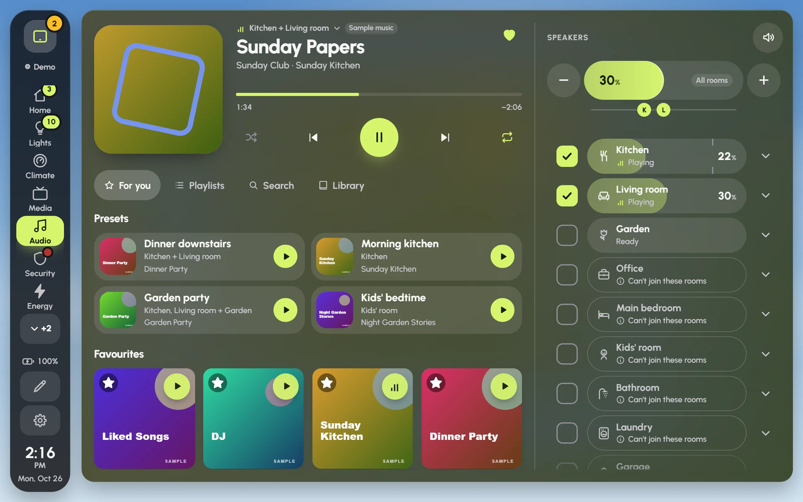

The Audio page plays music on the speakers around your home: tick the rooms, pick something, and set how loud each room plays. Glow plays music through Music Assistant, or Spotify through spotcast (from HACS), whichever your Home Assistant has.

## Before you start

**Settings › Audio** sets it up. Press **Set up audio** and Glow looks at what Home Assistant has, then suggests one room for each area, with the speakers matched by area and name. The steps are **Find**, **Rooms**, **Groups**, **Volume**, **Presets** and **Account**. After you add speakers to Home Assistant, **Find speakers again** looks once more.

TVs that can play music are listed apart and left out of the rooms at first. Add one if you want music on it, and it can be ticked like any room.

If your dashboard has no Audio page, **Settings › Pages › Add the Audio page** adds one. The setup wizard adds it by itself when Music is on.

## Playing something

1. Tick the rooms you want music in. On a wide screen they run down the right side; on a phone, the speakers line opens them.
2. Choose something from the tabs:
   - **For you**: your presets (rooms, levels and music in one tap), favourites, what this screen played lately, playlists, and radio stations.
   - **Playlists**: your playlists.
   - **Search**: playlists, songs, albums, artists and more.
   - **Library**: browse by artists, albums, songs and playlists.
   - **Up next**: what plays after this song (Music Assistant speakers only).
3. The music starts in the ticked rooms. The player at the top shows the song, with shuffle, back, play or pause, skip and repeat.

A few more things to know:

- **Tap a playlist or album** to see its songs; its round play button plays the whole thing. A song in the list plays the list from that song, so back goes up the list.
- **Every song's ⋯** has **Play next** and **Add to queue** while something is playing.
- **Hold a tile** to add it to your favourites, or take it out.
- **With spotcast**, **For you** also has Liked Songs and Spotify's DJ, and the player has a heart for liking a song.

The Audio page in the demo house: the player, the tabs and the presets on the left, the rooms on the right. The Kitchen and Living room are playing; rooms that can't join them say so.

## Up next

On Music Assistant speakers, **Up next** shows the song playing and the songs after it, with their lengths.

- Tap a song to play it now.
- Its **⋯** moves it to play next, up or down, or removes it.
- **Clear** empties the queue. The music stops, as it does in Music Assistant's own app, so Glow asks first.

## Room levels and the master slider

- **Each ticked room** is a slider: slide it to set that room's level.
- **All rooms**, above the rooms, moves every ticked room together; **−** and **+** step it.
- **The speaker button** beside the **Speakers** heading mutes every room at once, and turns them back on.
- **A room's arrow** opens its details: why it won't play and what to do, **−** and **+**, mute, its limit, and **Play only Kitchen** (or whichever room) to move the music there alone.

How **All rooms** moves the rooms is set in **Settings › Audio › Volume**, under **One slider for several rooms**:

- **Level**: each room keeps its own balance as you turn it up or down.
- **Balance**: rooms move together in proportion, from where they are now.
- **Same**: every ticked room plays at the same level, under its own limit.

The same place has two safety limits. Music starting from silence plays no louder than the **First play limit**, and **Quiet hours** keep every room under a lower limit at night.

## This screen's room

**Settings › Audio › This screen's room** tells Glow which room the screen is in. It's kept on this screen only.

- That room is marked **Here** on the Audio page.
- The screensaver shows what plays there, with keys that work without waking the screen. See [Screensaver and night](screensaver-and-night.md#while-music-plays-here).
- Nothing is guessed: without a room set, the screensaver stays as it is.

The same section has **Kids mode** for this screen, which keeps every room under the kids' limit and shows the kids' favourites instead of search.

## Music Assistant notes

- **Unticking a room while music plays** mutes it at once but keeps it in Music Assistant's group, so the music never stops or jumps in the other rooms. Glow lets the room go properly at the next song, or when the music is paused or stopped. Ticking it again before then only turns it back up.
- **Rooms ready ahead** (**Settings › Audio › Volume**, under **Adding and taking out rooms**; off by default): when music starts, the other rooms that can play with it join the group quietly, so ticking any of them later is instant. The cost: anything else that plays to one of those rooms, such as an automation, plays to the whole group while they're joined.
- **Rooms that can play together**: Music Assistant only syncs speakers of the same kind, such as AirPlay with AirPlay. A room that can't join the ticked ones is greyed with "Can't join these rooms". Its **Play only** button plays it on its own instead.
- **Apple TVs** asleep in standby show "Asleep · wakes for music", not offline. Sending music to one wakes it first, then the music starts. There's no power button to press.

## Different music in different rooms

Several groups of rooms can play different music at the same time.

1. Tap the line above the song's title (such as "Kitchen + Living room"). It lists every group that's playing.
2. Pick **Something else on other rooms**. The ticks clear, and the first music plays on.
3. Tick other rooms and choose something for them.

The same list switches between groups later. The player, the queue and the ticks follow the group you picked. A room that's playing other music says what; ticking it moves it over to the group on screen.

## When something won't play

Rooms that can't play say why in plain words, such as **Offline**, **Not set up to play** or "Can't join these rooms". The room's arrow opens the full reason and what to do about it. **Settings › Audio** says at the top whether music can start from here, or what's missing. More in [Troubleshooting](troubleshooting.md#music-doesnt-start-or-a-room-is-greyed).
