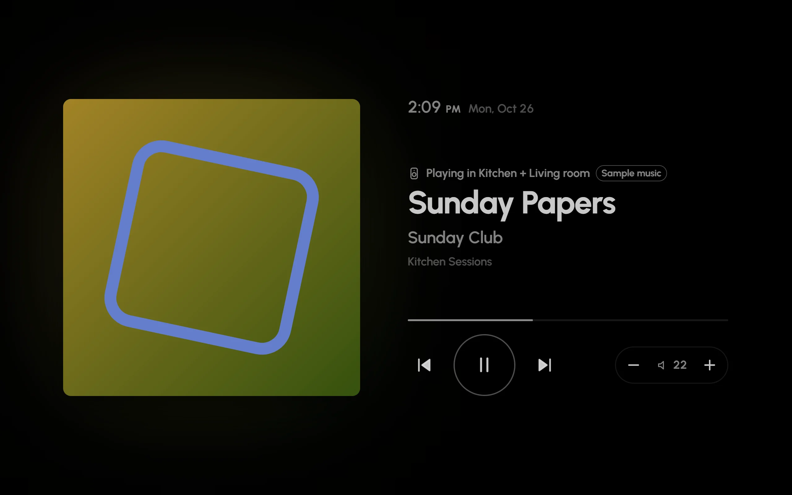
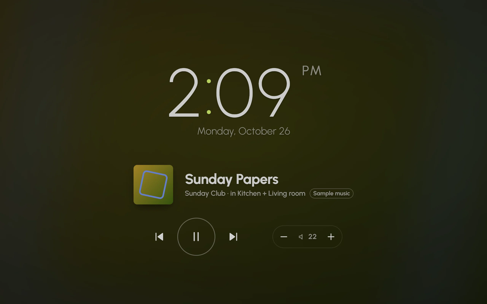

After a while without a touch, Glow shows a screensaver: a clock you can read across the room, your photos, the sky, or nothing at all. It's on by default and starts after 10 minutes. The first touch only wakes the screen; it never presses anything underneath.

Everything here is in **Settings › Screensaver**, set for each dashboard.

## Preview

**Preview**, at the top, shows the screensaver as it's set up now, in its night look if it's night. A touch brings you back to Settings. **Preview with music** shows the music view, with what's playing in this screen's room, or a sample song when nothing is.

## Styles

- **Clock**: a big clock in the face you choose, with the weather and any alerts under it.
- **Glance**: the clock beside the weather, your next event, alerts and what's playing, like a bedside smart display.
- **Night**: a dim, deep-red clock on black that keeps a bedroom dark.
- **Photos**: your photos one after another, each slowly panning, with a small clock and caption in a corner.
- **Sky**: the sky as it is outside right now, with drifting clouds and a small clock.
- **Dim**: the dashboard stays, darkened.
- **Black**: a black screen. The least work for the tablet, and the darkest room.

Under the styles, each option appears for the styles it fits:

- **Starts after**: how long without a touch before it starts.
- **Clock face**: **Big**, **Stacked**, **Analogue**, **Chronograph**, **Words**, **Flip**, **Sun**, **LED** or **World**, with **Clock size** (**Small**, **Medium** or **Large**), **Hours** (**Auto**, **12 hour** or **24 hour**), **Seconds** and **Date**.
- **Beside the clock**: **Weather**, **Next event**, **Alerts** and **Now playing**.
- **Photos**: **Add albums and folders** from Home Assistant's photo sources (such as Immich, Google Photos or local media), or add pictures by address or from this screen. **Each photo** either fills the screen with a slow pan, or shows whole and still. **Captions** shows a photo's name under the clock.
- **Screen care**: **Brightness**, and **Move things around**, which slowly drifts the clock and extras and swaps their places every few minutes, so nothing sits on the same pixels for long.
- **Wake when someone's there**: under **Wake with**, choose a motion or presence sensor, and the screensaver lifts as someone walks up. **Only a touch** keeps it to touches.

## While music plays here

When music plays in this screen's room, the screensaver can show the song, with keys that work without waking the screen.

- **Now playing** (the default): the song takes over the screensaver: its artwork, a title big enough to read across the room, and play, skip and volume.
- **Clock on the cover**: your clock over the album art, softly blurred and dark, with the song and its keys under it.
- **Add a strip**: your screensaver as it is, a little smaller, with a slim strip for the song and its keys along the edge.
- **Off**: the screensaver stays as it is while music plays.

**Now playing**, previewed with the sample song: the artwork, the title, the keys, and this room's volume.

The keys (back, play or pause, skip, and **−** and **+** for this room's volume) work without waking the screen, even if your finger lands between two of them. A touch anywhere else, the artwork and the title included, wakes it as usual. The song stays on the screensaver for five minutes after a pause, so you can press play again.

**Clock on the cover**: the clock over the blurred album art, with the song and its keys under it.

Good to know:

- This needs the screen's room, set in **Settings › Audio › This screen's room**. Glow doesn't guess: without a room, the screensaver stays as it is, and **Settings › Screensaver** says so, with a way to set it.
- Music playing only in other rooms leaves the screensaver as it is.
- With the **Black** style the screen stays black, music or not.

## At night

**At night**, at the end of **Settings › Screensaver**, chooses the screensaver's night look:

- **Red**: every clock turns a dim deep red, and the photo frame and the sky become the night clock, so the room stays dark. Music shows without its artwork.
- **Black**: the screensaver goes black. A dimmed dashboard stays dimmed.
- **As is**: the same day and night. Night mode still dims it.

This follows the dashboard's night mode, so it waits until night mode is on.

## Night mode

**Settings › Behaviour › Night mode** dims the whole screen at night, so the hallway isn't lit up. It's on by default, from 10 pm to 6:30 am.

1. Under **When**, choose **Sunset to sunrise** or **Set times**. Sunset to sunrise needs Home Assistant's Sun integration.
2. For set times, fill in **From** and **Until**.
3. Slide **How dark at night** until it suits the room.

Pop-ups and sheets dim along with the page, and card animations calm down. With Fully Kiosk's JavaScript interface, Glow turns the tablet's backlight down instead of laying a dark layer over the screen; see [Wall tablets](wall-tablets.md#kiosk-browser-tips).
