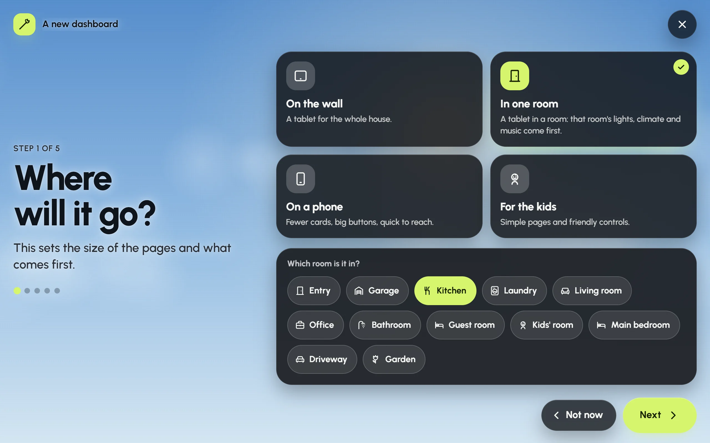
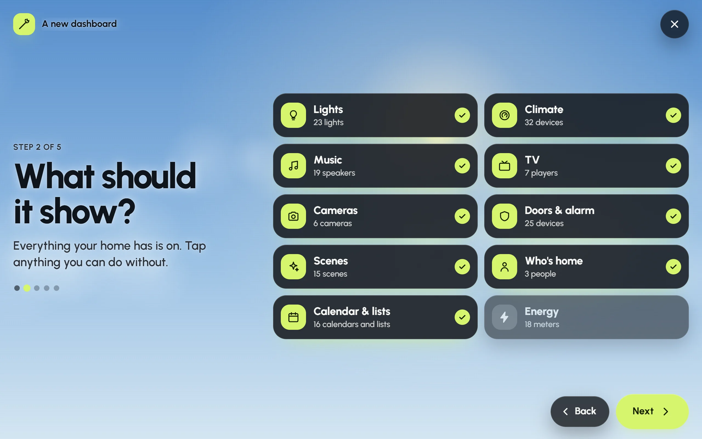
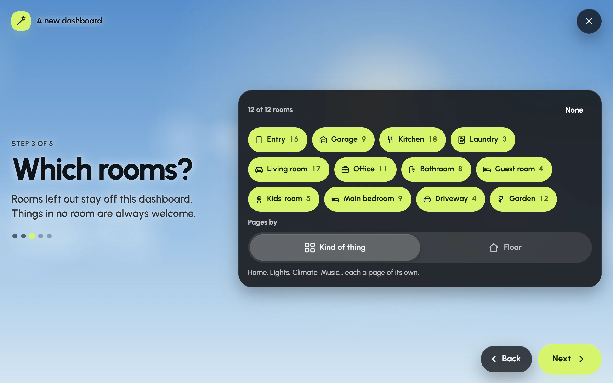
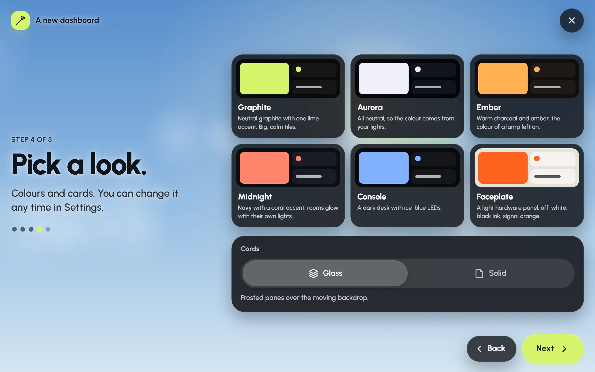
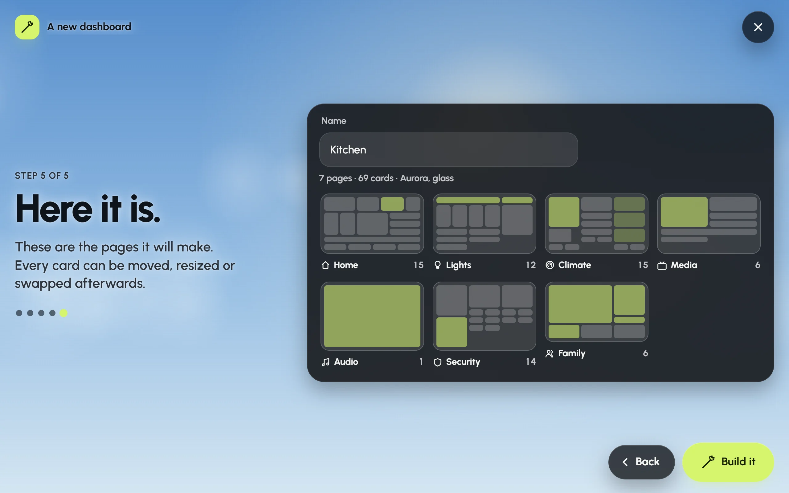

Building a dashboard card by card takes a while. The setup wizard makes the first version for you. It asks where the screen goes, what it should show, which rooms and which look, then draws the pages before it makes anything. Nothing is saved until you press **Build it**.

Move through it with **Next** and **Back**. **Not now** on the first step, or the **×** in the top corner, closes it.

## Step 1: Where will it go?

Step 1 with **In one room** chosen and the Kitchen picked as its room.

This sets the size of the pages and what comes first.

- **On the wall**: a tablet for the whole house.
- **In one room**: a tablet in a room. Glow asks **Which room is it in?** and puts that room's lights, climate and music first.
- **On a phone**: fewer cards and big buttons, quick to reach.
- **For the kids**: simple pages and friendly controls.

### What "In one room" does

The room you pick comes first throughout the dashboard. On the Home page, its lights, thermostat and speaker sit at the top.

It also becomes this screen's room for music, if the screen doesn't have one yet and the room has a speaker in your audio setup. That room is then marked **Here** on the Audio page, and it's the room the screensaver shows music for. You can change it later in **Settings › Audio › This screen's room**.

The rooms come from Home Assistant's areas. If your Home Assistant has no areas yet, Glow says so: add areas in Home Assistant first, or choose **On the wall**.

## Step 2: What should it show?

Step 2 in the demo house: everything is on except Energy, which has been tapped off.

Glow lists only what your home has, with how many of each: **Lights**, **Climate**, **Music**, **TV**, **Cameras**, **Doors & alarm**, **Scenes**, **Who's home**, **Calendar & lists** and **Energy**. Everything starts switched on. Tap anything you can do without to leave it out.

Kinds of things your home doesn't have are named underneath. When you add them to Home Assistant later, they appear on the dashboard by themselves.

A few things aren't on this list because any dashboard may show them: the weather, safety alarms such as smoke and leak sensors, timers and robot vacuums.

## Step 3: Which rooms?

Step 3: every room is ticked, each with how many things it has, and the pages go by kind of thing.

Each room shows how many of the chosen things it holds. Tap a room to leave it out. **None** clears the list and **All rooms** fills it again. Things that aren't in any room are always included.

For a tablet (**On the wall** or **In one room**), **Pages by** chooses how the pages are laid out:

- **Kind of thing**: Home, Lights, Climate, Music and so on, each a page of its own.
- **Floor**: a summary first, then a page for each floor, room by room. When Home Assistant has no floors, this choice is called **Room** and makes a page for each room.

## Step 4: Pick a look

Step 4: six palettes, each drawn in its own colours, and glass or solid cards below.

Choose one of the six palettes (Graphite, Aurora, Ember, Midnight, Console or Faceplate), then **Glass** or **Solid** cards.

- **Glass**: frosted panes over the moving backdrop.
- **Solid**: opaque cards, the lightest work for an older tablet.

Each palette brings a background that suits it. You can change all of this later in **Settings › Appearance**; see [Colours and backgrounds](looks.md).

## Step 5: Here it is

Step 5: every page the wizard will make, drawn in miniature before anything is saved.

The last step shows every page the wizard will make, each drawn in miniature with its cards where they'll sit on a tablet, and a summary such as "8 pages · 73 cards · Aurora, glass".

1. Check the pages. If something's missing, go **Back** and change your answers.
2. Give the dashboard a name, or keep the one it suggests (the room's name for a room tablet).
3. Press **Build it**.

The new dashboard opens on this screen, and a message says what was built, with **Undo**. Press **Undo** to take the whole build back. Once it's built, every card can be moved, resized, restyled or removed; see [Editing your dashboard](editing.md).

If nothing in your home fits your answers, the preview says so. Go **Back** and pick more things or rooms.

## Left out stays out

Your answers are kept with the dashboard. When Glow later finds new devices in Home Assistant (see [Found automatically](found-automatically.md)), it skips the kinds of things and the rooms you left out. A kitchen tablet set up without cameras won't gain a camera card next month.

If you kept everything on, that means everything, including what comes later, so new devices of any kind still arrive. You can still add a left-out thing yourself with **Add card**, or with **Add again** in **Settings › Integrations**.

## Running it again

The wizard fills an empty dashboard or makes a new one. It never rebuilds a dashboard that already has cards.

- **An empty dashboard** shows **Let's build this dashboard** with **Set it up for me**. Press it to start the wizard. The result keeps the dashboard's place, so every screen showing it follows. If the dashboard has an edit PIN, Glow asks for it first.
- **A new dashboard**: go to **Settings › Dashboards**, press **New dashboard**, choose **Guided** (the first choice) and press **Start the setup**.

To start an existing dashboard over, make a new one with **Guided** and look it over. Then open the old one in **Settings › Dashboards** and press **Delete**.
