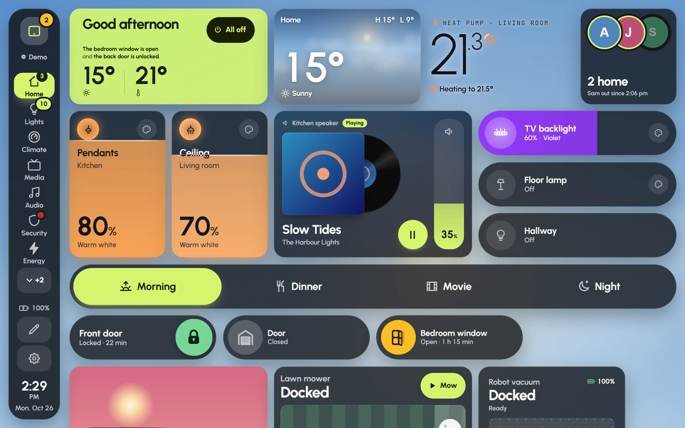

A wall tablet can show Glow in two ways: through Home Assistant's sidebar, or on the app's own port. Most homes should use the first.

## Through Home Assistant's sidebar (recommended)

The tablet signs in to Home Assistant like any other device and opens Glow from the sidebar.

1. In Home Assistant, give the tablet a user of its own, such as "Kitchen tablet". Add it under **Settings › People** and allow it to log in.
2. On the tablet, open your Home Assistant's address and sign in as that user.
3. Press **Glow** in the sidebar.
4. If you use a kiosk browser such as Fully Kiosk, copy the address the browser shows now and use it as the kiosk's start page.

This uses Home Assistant's own sign-in, and the tablet has only the access its own user has. The tablet's user doesn't need to be an administrator: it can use every card. It can't save changes to the shared dashboards by itself; see [Who can save changes](editing.md#who-can-save-changes).

## On the app's own port

Glow also answers on a port of its own:

`http://<Home Assistant's IP>:8199/`

Home Assistant shows its IP address under **Settings › System › Network**.

- The first time, the tablet asks for your Home Assistant's address and a sign-in: press **Connect to Home Assistant** and follow the steps. With **No sign-in** on (below), it skips this.
- The port is on by default. To change its number, or to close it, open the app's **Configuration** tab, change or clear the port under **Network**, press **Save** and restart the app.

### No sign-in

With **No sign-in on the home network** turned on, tablets that open the app's port show the dashboards without signing in at all. The app then acts for them with the access Home Assistant gives apps.

> **Only turn it on for a home network you trust**, never on a guest network. The app refuses the dangerous parts (apps, backups, restarts, user accounts), but anyone on your Wi-Fi could still switch your lights, unlock a door or watch a camera through it.

To turn it on:

1. Open the app's **Configuration** tab.
2. Turn on **No sign-in on the home network** and press **Save**.
3. Restart the app.

Then open Glow on the tablet by Home Assistant's IP address, as above. A name such as `homeassistant.local` isn't accepted without a sign-in, and neither is a tablet outside your home network. The sidebar always uses your own sign-in, whatever this setting says.

## Kiosk browser tips

Fully Kiosk Browser is the usual app for wall tablets, and Glow uses its extras when they're there. On a Fire tablet, install it from Fully's own website, because Fire tablets don't come with Google Play.

- **Start URL**: Glow's address, from either way above.
- **Keep Screen On**: turn it on. A plain `http://` address can't hold the browser's own wake lock, so Fully does the job.
- **Fullscreen Mode** and **Hide Status Bar** (Fully's appearance settings): turn them on. Besides hiding the bars, this lets a swipe down from the top edge reach Glow's notification shade instead of the tablet's own status bar. The button at the top of Glow's rail opens the shade either way.
- **Enable JavaScript Interface** (advanced web settings; some of it needs Fully PLUS): lets Glow turn the backlight down at night and for the dim and black screensavers, wake the screen for the doorbell, and show the tablet's battery.
- **Pull to refresh** and Fully's own screensaver: turn them off if you use Glow's screensaver. Running both is confusing.
- **Launch on boot** and **Kiosk mode** keep the tablet on Glow after a power cut.
- **Autoplay videos**: allow it, so camera streams start without an extra tap.

## Settings › This screen

These settings stay on the tablet you set them on.

- **Name**: what this screen is called, such as "Kitchen tablet".
- **Dashboard on this screen**: which dashboard it shows. Each dashboard in **Settings › Dashboards** also has **Show on this screen**.
- **Keep the screen awake**: keeps the display on while Glow is open. It's on by default, and needs an `https://` address. On `http://`, use Fully's **Keep Screen On** instead.
- **Effects on this screen**: **Auto**, **Full** or **Light**. **Auto** watches how smoothly this screen draws and steps down by itself when frames drop: first the sky holds still and cards turn solid, then card animations calm down, then fewer of them move at once. **Light** starts with the sky still and solid cards. **Full** keeps every effect on.
- **Motion on this screen**: **As the dashboard**, **Calm** or **Still**, for a screen where movement distracts.
- **When you change page**: **Auto**, **Instant**, **Fade**, **Slide** or **Wave**. **Instant** is the quickest. **Keep every page ready** builds every page ahead, so a page change shows at once; turn it off if the tablet runs short of memory.
- **Reload every night**: reloads at 3:30, once nobody is using the screen, to clear the slow build-up of a browser that never closes. It's on by default. **Reload now** saves first, then reloads.
- **Battery**: the tablet's charge, when the browser or Fully shares it. A tablet kept at 100% all day can swell over the years; a smart plug that keeps it between about 40% and 80% helps.

## The Amazon Fire HD 10

Glow is built for the Fire HD 10. Its browser engine is a few years old and its graphics are modest, so a few choices help.

- **Solid cards are the lightest.** On a Fire tablet, Glow starts with its effects reduced, which means solid cards and a still sky. If the tablet keeps up, **Effects on this screen › Full** brings glass back.
- **Fewer, larger cards.** Every card is live. Keep each page to about a screenful.
- **Instant page changes** (**When you change page › Instant**) are the quickest.
- **Night dimming** follows a schedule or the sun, because the Fire HD 10 has no light sensor. See **Settings › Behaviour › Night mode**.
- **A fixed address.** Give the tablet a fixed address on your router, and open Home Assistant by its local address rather than a cloud address, for the quickest controls.

In landscape the Fire HD 10 is 1280 pixels wide, so it gets the wide layout the dashboards are drawn for, with the page rail down the side. Upright, it gets the narrower tablet layout.
